<div align="center">



<h1 style="font-size:2.6em;line-height:1.2;margin-top:.2em;">dolmo paste</h1>

<p style="font-size:1.15em;line-height:1.6;margin:0 auto;max-width:46em;">
macOS 剪贴板管理器。常驻菜单栏，记住你复制过的东西，键盘直达。
</p>

<p style="margin-top:1.4em;">
<a href="#快速开始"></a>
<a href="#快速开始"></a>
<a href="#数据"></a>
</p>

</div>

---

## 特性

| | |
| :--- | :--- |
| **全局唤起** | 默认 <kbd>⌘⇧V</kbd>，可在设置里改；菜单栏图标 / Dock 也能开 |
| **全类型捕获** | 文本 / RTF / 图片 / 文件引用，自动去重，设上限自动淘汰 |
| **即刻搜索** | 中文原文 + 拼音全拼/首字母双索引，打字即搜；<kbd>Tab</kbd> 循环切换类型过滤 |
| **一步粘贴** | 写回剪贴板并模拟 <kbd>⌘V</kbd> 直接粘入原 App（需辅助功能权限），支持纯文本粘贴 |
| **Quick Paste** | <kbd>⌘1</kbd>~<kbd>⌘9</kbd> 快速粘贴前 9 条 |
| **Pin 固定** | 固定常用片段，永不过期 |
| **图片查看** | 悬停预览（窗口可拖边/拖角放大，滚轮/捏合做卡内放大镜、可平移，双击放大/还原）+ 全屏大图查看器 |
| **截图 OCR** | Vision 识别图片内文字，搜索可命中 |
| **两套主题** | 跟手系统样式 / 自研 dolmo design（暖纸、橙色强调） |

<div align="center">

<h3 id="数据">
数据只在本机
</h3>

<p style="font-size:1.05em;">
<code>~/Library/Application Support/dolmo-paste/</code><br>无任何网络代码
</p>

</div>

---

## 快速开始

> **要求** macOS 14+，已安装 Xcode 命令行工具。

```bash
git clone https://github.com/nature-tr/dolmo-paste.git
cd dolmo-paste
./build.sh                                    # 产出 dolmo-paste/build/dolmo paste.app
cp -r "build/dolmo paste.app" /Applications/  # 建议装到这里，权限和开机启动才稳
open "/Applications/dolmo paste.app"
```

首次启动会引导授予 **辅助功能** 权限，它只用于两件事：

1. 模拟 <kbd>⌘V</kbd>，把选中内容直接粘进你正在用的 App（不授权则内容只回到剪贴板，自己按 <kbd>⌘V</kbd>）
2. 把浮窗显示在输入光标旁边（不授权则显示在鼠标附近）

关掉的话功能仍然可用，只是多按一次键。

---

<div align="center" style="font-size:.95em;">

`⌘⇧V` 唤起 · 数据只在本机 · 无任何网络代码

</div>
